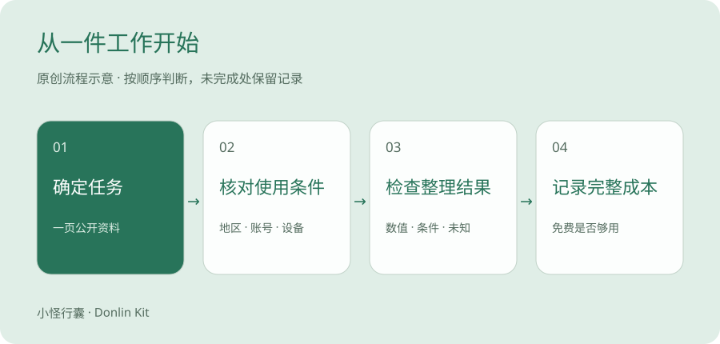

# 中国大陆上班族，如何选择适合自己的 AI 工具

先用同一份普通工作材料测试一款工具，再比较是否需要第二款。地区支持、账号和付款是独立条件。

> 官方资料整理＋原创方法 · 资料修订版 · 待本人实测 · 2026-10-28

下班后想用 DeepSeek 整理一页资料，搜了一圈，却先记住了会员、API、海外账号和网络线路。资料还没动，准备工作已经把人绕晕。

如果你也卡在这里，可以从一件很小的事开始。把一页能公开的材料，整理成自己看得懂的说明。

先做成一次。

## 把几个陌生词换成日常说法

网页版就像进餐厅点菜。你打开 DeepSeek 的对话页面，输入问题，直接看回答。API 则像把厨房接进自己的点餐系统，通常需要软件来调用。会用网页版，并不要求先学会 API。这个类比只解释使用方式，两者的产品条件和账单仍要分别看。

提示词就是你交代任务的话。与其输入「帮我整理」，不如说「请把这段参数整理成三列表格，保留原数值，没有的信息写未提供」。

说真的，刚开始把精力放在表达任务上，比记住一串产品缩写更有用。

## 先明确你这次想完成什么

适合已经会使用电脑和手机、希望把 AI 用于日常工作的读者。本篇先帮助你完成工具筛选，不要求编程或购买海外号码。

把「我要学 AI」改写成一个能验收的任务。例如，把一页公开技术资料整理成一张参数说明表；或者把自己的经历整理成一篇图文。



原创示意图，任务、使用条件、结果质量、成本，按顺序筛选。

## 先认识三个候选，不做未经测试的排名

| 候选 | 已核对的官方信息 | 本周怎么试 | 费用与资格 |
| --- | --- | --- | --- |
| Codex | 官方说明区分 ChatGPT 登录的订阅访问与 API 密钥按用量访问。 | 先确认实际登录类型，再完成一次资料整理任务。 | 先辨认具体产品与账单；不把订阅和 API 费用合并。 |
| DeepSeek | 官方首页有网页版与 API 独立入口。 | 用下方同一段材料，检查数值与遗漏。 | 个人产品价格与资格待本人核实；API 价格不能替代网页版价格。 |
| 千问（通义入口跳转） | 通义入口目前跳转到千问。 | 作为补充候选，完成同任务测试并记录所用入口。 | 已确认入口与名称；具体功能、价格和账号要求待核实。 |

## 用同一个小任务做比较

先选你现有能正常使用、本人符合条件的一款。新建一个会话，粘贴下面的提示词和教学材料。记录工具名称、所选模式、日期、输入、原始输出与耗时。

Codex 的开发工作流与普通聊天工具的入口和定位不同；这里比较同一小任务的完成情况，不按品牌做通用能力排名。

本篇不宣称三款产品已经完成横向实测。工具对照表中的本人测试栏暂为空，等你实际操作后补充。

```text
请只根据原文，输出“项目｜数值与单位｜含义｜原文未提供的信息”。
不要推断防水、精度、接线或安全等级。
原文：采样周期100 ms；汇总上报周期1 s；正常工作温度0～40 ℃。
```

## 用四个问题决定是否继续用

可以给「数值、信息边界、结构、修改成本」各记 0～2 分。这个分数只是你的任务记录，不是产品综合能力排名。当前工具满足任务时，先重复使用三次，再考虑增加工具。

1. 数值和单位是否保持一致？100 ms 和 1 s 是否被区分？
2. 没有提供的信息是否明确保留为未知？
3. 结果能否被你快速核对和修改？
4. 实际任务频率是否足以支持持续付费？

## 海外 AI 服务要多核对一层

核对实际使用地区、本人账号条件和付款要求。能打开网页、拥有海外手机号或付款卡，各自都不能单独证明符合服务资格。

本次核对的 OpenAI 文档针对 API 服务，并说明列表范围之外的使用可能导致账号被封禁或暂停。它不能替代 ChatGPT 自身的地区及订阅规则。此处不提供绕过地区或身份审核的方法。

## 完成这一篇后，你应该拿到什么

1. 一个具体任务和一款主工具。
2. 一份原始输入、原始输出及核对记录。
3. 一个决定，继续免费使用、继续观察，或有依据地考虑付费。

## 按照你今天的任务选入口

| 今天要做什么 | 起步方法 | 怎样算完成 |
| --- | --- | --- |
| 整理公开资料或写图文 | 先用自己已能正常使用的 DeepSeek 网页版。千问作为补充候选，实际功能需再确认。 | 保留原文和结果，逐项检查数字、条件及遗漏。 |
| 整理代码、修改网页或处理项目文件 | 已经使用 Codex 的读者可沿用当前工作环境，先只处理教学材料。 | 文件能打开，改动能解释，能回到原稿。 |
| 在自己的程序中批量调用 | 确实需要程序调用时，再研究 API。 | 明白接口、密钥、计费、额度与错误处理后再接入。 |

## 一次十五分钟的练习

找一段三到五行的公开文字，或者用第 4 篇的 T-01 教学卡。先复制保存原文，再把它交给你现有的一款服务。记录实际入口，不要只写品牌名。

拿到回答后，把原文放左边、结果放右边。逐个圈出数值和单位，再查有没有多出来的结论。比如原文没有防水等级，结果就不该出现「防水」。

看不懂的术语可以再追问「请换成一个第一次上班的人能理解的说法，保留数值和适用条件」。解释仍要对照原文，不能因为更顺口就默认正确。

你想想看，能发现并修正一个具体错误，已经比收藏十篇工具排行榜更接近自己的工作需求。

## 买会员前，先留下一份作品

担心免费额度不够很正常。先观察它究竟卡在哪一步，文件太长、次数不足，还是结果不准确。不同问题对应不同处理方法。

其实吧，订阅能否解决问题，要看官方套餐具体包含什么。答案不准确时，先缩小材料、写清要求、做好核对，再判断付费是否有帮助。

工具的价值可以用一件作品来判断。这篇说明能不能看懂，下一次还能不能照着做，自己需要花多少时间修正。今晚先留下这一件。

冬零小怪 · 小怪行囊 · Donlin Kit

如果这篇帮你看懂了一步，可以收藏、分享给同样刚开始的朋友，也欢迎记下还没看懂的问题。

## 来源与核查范围

1. [OpenAI 官方认证说明](https://learn.chatgpt.com/docs/auth)。已读取官方认证原文，核对 ChatGPT 订阅访问与 API 按用量访问的区别，以及认证缓存保护说明。未读取或更改个人凭证。 核查日期 2026-10-28。

2. [DeepSeek 官方首页与网页版入口](https://www.deepseek.com/)。已阅读官方首页；确认网页版、应用下载、API 平台是不同入口。未核实个人订阅价格与本人账号资格。 核查日期 2026-10-28。

3. [千问官方入口（通义入口跳转）](https://www.qianwen.com/)。通义入口跳转至千问，已读取官方页面标题。当前账号、功能和费用条件待本人进一步核实。 核查日期 2026-10-28。

4. [OpenAI API：支持的国家与地区](https://developers.openai.com/api/docs/supported-countries)。已阅读 API 地区列表及使用范围说明。这是 API 文档，不能据此推定 ChatGPT 的地区或订阅条件。 核查日期 2026-10-28。

本文未加入推荐佣金链接。个人工具实测、订单及资格仍待本人验证。
