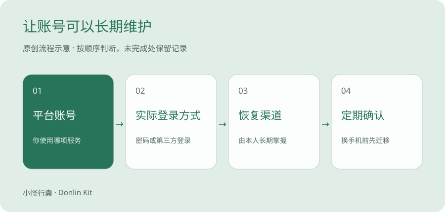
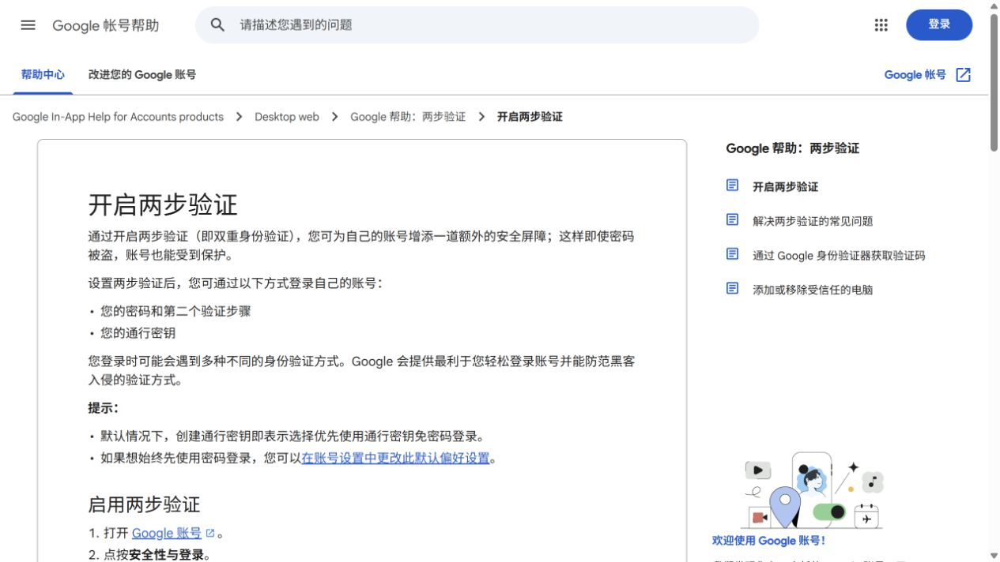

# 使用 AI 前，邮箱、账号和恢复方式怎么准备

分清邮箱、登录方式、平台账号和恢复渠道。先整理现有账号，再按实际服务增加。

> 原创操作方法＋官方查询入口 · 资料修订版 · 待本人实测 · 2026-10-28

换了一部手机，邮箱还能打开，平时用的账号却要求旧设备验证。之前一路点「继续」，现在才发现自己说不清当初是怎么登录的。

这是一个假设场景。对第一次接触 Gmail、DeepSeek 或 Codex 的读者，最该弄明白的就是这件事。

账号怎么进，也得知道怎么找回。

## 邮箱像信箱，登录方式像钥匙

Gmail 是邮箱服务。你可能用它收账单，也可能用 Google 账号登录另一项服务。这两件事有关联，但不是同一个动作。

假设你在一项服务里点了「使用 Google 继续」。下次登录时应先回想自己选的方式，别看到密码框就反复尝试一个从没给该平台设置过的密码。这个例子只帮助理解，具体入口看该平台当前页面。

说真的，记住「我用什么方式进来的」，经常比再注册一个备用账号更有帮助。

## 先分清四个角色

| 角色 | 用途 | 你需要记录什么 |
| --- | --- | --- |
| 邮箱 | 收通知、业务联系或恢复邮件。 | 只在私人记录中记别名、是否能登录、是否有恢复方式。 |
| 平台账号 | 登录具体 AI 服务。 | 服务名称、本人使用状态、官方登录入口。 |
| 登录方式 | 密码、手机验证或第三方登录等。 | 你实际采用哪一种；不是把密码写到资料表。 |
| 恢复方式 | 丢失设备或无法登录时找回。 | 恢复入口和备用方式是否仍由本人掌握。 |



原创示意图，平台账号、登录方式与恢复渠道需要分别确认。

## 先整理现有账号，30 分钟就能开始

不要为了「准备齐全」批量注册账号。每增加一个账号，都增加一份维护责任。

1. 列出你正在使用的 AI 与邮箱类型，不需要提供完整地址。
2. 用本人设备确认邮箱和常用 AI 是否还能正常登录。
3. 在官方安全设置里查看当前支持的恢复和验证选项。
4. 确认旧手机号是否仍在使用，备用邮箱是否能收到通知。
5. 记录完成日期和未解决问题，保存在私人执行资料中。

## 设置独立密码与可恢复的验证方式

重要账号使用独立密码，可以采用本人掌握的密码管理器。平台支持多因素认证时，先看清迁移与恢复说明，再启用适合自己的方式。

恢复代码属于敏感凭证，妥善单独保存。公开截图只保留菜单和操作说明，隐去邮箱、手机号、二维码、验证码、支付和账户标识。

## 换手机或号码前先做迁移

如果已无法登录，从该服务的官方找回入口开始；先记录报错和已有恢复条件，不把账号交给陌生人托管。

1. 确认新设备能登录重要账号。
2. 按平台官方说明迁移验证器或其他验证方式。
3. 更新已停用的恢复号码和邮箱。
4. 确认新方式生效，再处理旧设备或旧号码。

## 哪些信息放在什么地方

| 公开教程可以放 | 私人执行记录可以放 | 不在普通记录表中保存 |
| --- | --- | --- |
| 服务名称、脱敏截图、一般步骤。 | 账号别名、邮箱类型、恢复设置状态、最后确认日期。 | 密码、验证码、恢复代码、API 密钥、完整证件及支付资料。 |

## 如何验收

你能说清楚，这个账号用什么登录、通知发到哪里、设备丢失时先查哪个入口。私人记录中只填写状态与别名；公开文章不包含可识别你的登录凭证。

本篇未登录你的账户核实设置，具体菜单与可用验证方式以相应服务的当前页面为准。



Google 官方两步验证帮助页公开截图，2026-10-28。展示的是官方说明，不代表个人设置已经完成。

## Gmail 已经在用，接下来做什么

在本人常用设备上打开 Google 官方账号页面，从账号菜单进入安全相关设置。确认当前恢复邮箱、恢复手机号和验证设备是否仍归自己掌握。本文没有登录个人账号，不提供未经确认的逐按钮截图。

如果页面显示两步验证、通行密钥或验证器等选项，先阅读它自己的设置和恢复说明。两步验证是在原有登录之外再确认一次身份；通行密钥是一种依靠设备解锁等方式验证的登录凭据。不要因为名字陌生就同时开一堆自己不会恢复的方式。

其实吧，最好的配置是你能长期维护的配置。换手机前，先在新设备验证登录和恢复路径，再处置旧设备。

## 一行私人记录就能说明白

这张记录相当于给自己留一张门牌说明。它应该告诉你去哪里找，不应该变成钥匙串。

你想想看，如果电脑坏了，只留下存在那台电脑里的恢复代码，恢复仍然可能很困难。按服务说明安排自己能取得的备份，必要时使用受保护的离线存放方式。

```text
服务别名    教学账号 A
通知邮箱类型    Gmail
实际登录方式    由本人按实际情况填写
恢复渠道状态    已确认 / 待确认
最近确认日期    年-月-日
下一步    只记录动作，不记录密码、验证码或恢复代码
```

## 截图怎样让别人看懂，又不暴露自己

教程需要的是菜单位置、选项名称和操作结果。邮箱、手机号、二维码、恢复代码、设备标识及支付信息不需要出现在图里。

先裁掉无关区域，再用不透明色块遮挡，导出一张新的图片。重新打开导出图检查，别只在编辑器里盖住一层就发原文件。

坦率地讲，本文配的是关系示意图。它不代表你的 Gmail 已经开好两步验证。今晚只完成一次本人核对，哪怕还有一项待确认，也写清楚下一步。

冬零小怪 · 小怪行囊 · Donlin Kit

如果这篇帮你看懂了一步，可以收藏、分享给同样刚开始的朋友，也欢迎记下还没看懂的问题。

## 来源与核查范围

1. [OpenAI 官方认证说明](https://learn.chatgpt.com/docs/auth)。已读取官方认证原文，核对 ChatGPT 订阅访问与 API 按用量访问的区别，以及认证缓存保护说明。未读取或更改个人凭证。 核查日期 2026-10-28。

2. [DeepSeek 官方首页与网页版入口](https://www.deepseek.com/)。已阅读官方首页；确认网页版、应用下载、API 平台是不同入口。未核实个人订阅价格与本人账号资格。 核查日期 2026-10-28。

3. [千问官方入口（通义入口跳转）](https://www.qianwen.com/)。通义入口跳转至千问，已读取官方页面标题。当前账号、功能和费用条件待本人进一步核实。 核查日期 2026-10-28。

4. [Microsoft 账号安全入口](https://account.microsoft.com/security)。官方查询入口，未登录核实本人安全设置。菜单与验证方式以账号当前页面为准。 核查日期 待核查。

5. [Google 官方帮助，开启两步验证](https://support.google.com/accounts/answer/185839)。已读取公开中文帮助页，核对启用入口、第二个验证步骤与通行密钥说明。未登录或更改个人账号。 核查日期 2026-10-28。

本文未加入推荐佣金链接。个人工具实测、订单及资格仍待本人验证。
