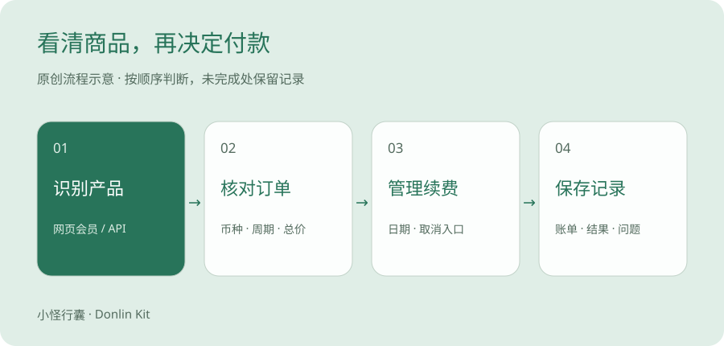
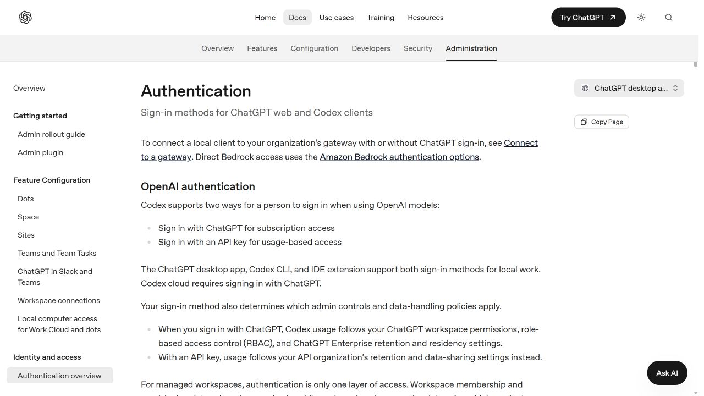
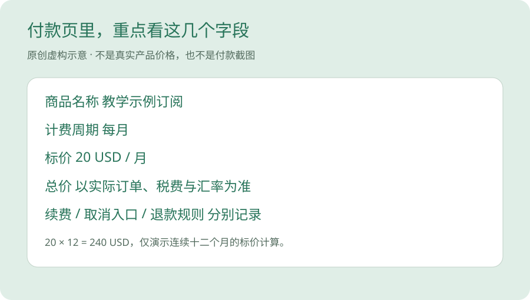

# AI 工具订阅怎么付款，付款前检查什么

先区分网页版订阅、API 计费和应用商店购买，再核对资格、账单与取消方式。

> 原创判断方法＋官方入口 · 资料修订版 · 待本人实测 · 2026-10-28

同一个品牌，网页里有会员，开发者平台里又有余额。钱已经花过，打开另一个入口却还是提示额度不足。

如果你正准备第一次付款，先把购买对象看清楚。

品牌名相同，不足以说明账单相通。

## 会员像月票，API 更像按使用量记账

月票类比适合帮助理解订阅，按月或按年购买特定套餐内的权益。API 则经常根据实际调用消耗来计费，具体计价单位、额度和限额由对应产品说明。

这里的关键是看官方账单。不能因为 DeepSeek 首页同时有聊天和 API 链接，就推断两个入口用同一份余额。也不能把 Codex 所有登录方式都理解成同一种订阅。

说真的，付款之前先说清「我在哪个入口，买哪个商品」，后面的麻烦会少一些。

## 先确认你要购买的产品

| 购买对象 | 先确认的问题 | 容易混淆的地方 |
| --- | --- | --- |
| 网页版订阅 | 订阅名称、计费周期、包含功能与实际账号。 | 买了某个网页套餐，未必包含 API 用量。 |
| API 服务 | 接口产品、计费单位、额度、限额和账单入口。 | 按调用计费和网页会员是两种产品路径。 |
| 应用内购买 | 是否由应用商店结算、商店账号和订阅管理入口。 | 网页取消与商店订阅取消可能是不同入口。 |

## Codex 的登录与费用先分开辨认

官方认证说明列出 ChatGPT 登录的订阅访问，以及 API 密钥按用量访问。它们对应的账单和使用条件不同。先在本人界面确认当前方式，再判断自己要查哪种费用。

本篇不需要你贴出任何密钥、令牌或认证文件。也不代替你切换登录方式或更改安全设置。

原创示意图，先识别商品与购买渠道，再处理付款和续费。

## 付款前按这个顺序核对

账号资格、服务地区与付款成功分别判断，不用一张卡或一次验证码来推断全部条件。

1. 本人实际身份和使用地区是否符合该服务要求。
2. 当前登录的账号是否就是准备长期使用的账号。
3. 要购买的是网页订阅、API 额度还是应用内商品。
4. 订单页展示的金额、币种、周期、税费与优惠到期价格。
5. 官方接受的付款方式及本人发卡机构的交易条件。
6. 自动续费的下次日期、取消入口和退款规则。

## 用空白账单记录代替猜价格

| 字段 | 应从哪里填写 |
| --- | --- |
| 商品与渠道 | 本人打开的官方产品页或订单页。 |
| 首期实际支付 | 订单展示或已发生交易记录；未付款就写「未发生」。 |
| 持续费用 | 续费说明；金额或条件不明确时标为待确认。 |
| 汇率及其他费用 | 商家和付款机构说明；结算前不能保证固定汇率。 |
| 取消与退款 | 对应官方说明与本人可找到的管理入口。 |

## 需要境外付款工具吗？先从商家倒推

先检查目标服务接受的方式和你已有工具的适用性。确实有需求后，再研究额外的银行或付款工具。

付款工具的发卡地、卡组织、本人身份和商家限制是不同条件。此处没有推荐某张卡必然能完成付款，也没有办理金融账户。

## 失败后，先保留证据再判断

记录中隐藏卡号、账单地址和订单敏感字段。身份验证、付款和协议确认由本人在官方渠道完成。

1. 记录时间、实际商品、错误提示与已尝试步骤。
2. 到官方订单或订阅页面确认是否已经产生订单或扣款，避免重复购买。
3. 若已扣款但未开通，通过商家官方支持入口查询订单状态。
4. 若由发卡机构拒绝，向本人发卡机构核实，不连续更换不明付款渠道。

## 这一篇目前完成到哪里

已整理判断顺序与三类产品的差异，尚未进行你的付款实测。工具对照表不填写未经验证的订阅价格。

本次读取的 OpenAI 地区文档只适用于 API，不作为 ChatGPT 订阅或付款资格的依据。其他工具的付款功能以本人实际看到的官方商品为准。

官方 Authentication 文档公开截图，2026-10-28。页面分别列出 ChatGPT 订阅访问与 API 按用量访问。

## 把订单页当成商品说明读一遍

登录本人准备长期使用的账号，从产品自己的升级或账单入口查看商品。记录套餐名称、购买渠道、币种、周期，以及订单页显示的总价。还没准备好付款，也可以在这一步停下。

例如一份虚构订单写着每月 20 美元，这只能说明它标出的周期费用。若连续订阅十二个月，单算标价就是 240 美元，实际支出还要看税费、汇率与发卡机构费用。这是算账示例，不是任何服务的现价。

其实吧，月费是否便宜，要放回你的使用频率里看。只用过一次的功能，和每周都用的功能，值得投入的金额可能完全不同。

原创虚构订单示意，20 美元只用于解释账单字段，不对应任何真实套餐。

## 海外服务怎么付，答案在具体订单里

有的服务通过网页结算，有的可以通过应用商店购买，也有仅针对特定产品的账单平台。可用的卡种、发卡地区、账单资料和购买资格，需要分别看服务官方说明及实际订单。本文没有验证某张中国大陆银行卡对某个套餐必定可用。

不要为了试一个聊天功能，就把海外号码、银行卡、API 和服务器全部买齐。先确认自己已有方式是否满足要求。银行卡是付款工具，不能改变服务的地区与账号资格。

你想想看，连商品都还没确认，提前准备几张卡很难知道是在解决哪个问题。

## 扣款失败，先别连点几次

保留错误提示，查看官方订单状态，再向发卡机构确认是拒绝交易、待处理还是已经入账。银行显示的一笔待处理记录，不一定已经是最终扣款；状态由对应机构确认。

遇到扣费后没有权益，先核对购买账号、渠道及订单。提交给官方支持时，只在对方正规渠道按要求提供必要信息，普通笔记里不要保存完整卡号或安全码。

退款、取消续费和到期三个动作也要分别看。取消续费不等于已退款，也不自动说明什么时候失去权益。按你实际商品的说明记录。

## 付费之后留下两个位置

保存官方账单查询入口和订阅管理入口，再记下下次续费日期。可以在自己的日历里提前提醒，本项目不替你创建付费或续费操作。

坦率地讲，我们还没有你的真实订单记录，所以这篇给的是辨认方法。下次购买时，把商品与渠道写明，成功或失败都能留下有用的复盘。

冬零小怪 · 小怪行囊 · Donlin Kit

如果这篇帮你看懂了一步，可以收藏、分享给同样刚开始的朋友，也欢迎记下还没看懂的问题。

## 来源与核查范围

1. [OpenAI 官方认证说明](https://learn.chatgpt.com/docs/auth)。已读取官方认证原文，核对 ChatGPT 订阅访问与 API 按用量访问的区别，以及认证缓存保护说明。未读取或更改个人凭证。 核查日期 2026-10-28。

2. [DeepSeek 官方首页与网页版入口](https://www.deepseek.com/)。已阅读官方首页；确认网页版、应用下载、API 平台是不同入口。未核实个人订阅价格与本人账号资格。 核查日期 2026-10-28。

3. [千问官方入口（通义入口跳转）](https://www.qianwen.com/)。通义入口跳转至千问，已读取官方页面标题。当前账号、功能和费用条件待本人进一步核实。 核查日期 2026-10-28。

4. [OpenAI API：支持的国家与地区](https://developers.openai.com/api/docs/supported-countries)。已阅读 API 地区列表及使用范围说明。这是 API 文档，不能据此推定 ChatGPT 的地区或订阅条件。 核查日期 2026-10-28。

本文未加入推荐佣金链接。个人工具实测、订单及资格仍待本人验证。
