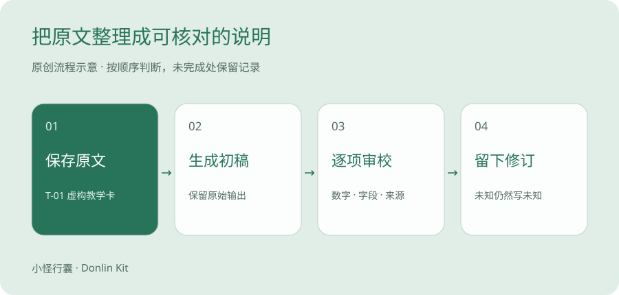

# 实例，用 AI 把技术资料整理成易读说明

使用虚构的 T-01 教学参数卡，完整展示原始输入、提示词、AI 整理稿、审校方法和最终示例。

> 自编材料＋本次助手演示 · 教学演示 · 待本人复现 · 2026-10-28

设想一个练习。把几行参数交给 Codex 整理，句子可能变顺了，但每个数字对应哪个含义，仍要回头核对。

如果你也常写设备说明，可以先用一份不涉及公司资料的练习材料，看看该怎样核对。

把文字写顺，只完成了一半。

## 给新手的解释，可以生活化到哪一步

100 ms 是 0.1 秒，1 s 是 1 秒，单看时间长度，两者相差十倍。但本卡写的是采样周期和汇总上报周期，所以整理时必须保留两个不同的名称。

你可以借用做笔记的动作理解。每隔一段时间记一笔，和隔一段时间把笔记汇总交出去，是两种动作。这个类比不说明 T-01 怎样存储数据、每包包含多少条，也不能推断真实设备内部行为。

说真的，类比只负责帮人听懂。参数结论仍然要回到原文。

## 案例边界与验收目标

本案例由当前编写助手基于自编材料生成，用于展示内容制作流程。它不是你已经完成的工具测试，也不是 DeepSeek、Kimi 或千问的产品测评。

材料使用虚构的参数卡，不包含公司资料或真实设备指令。目标是准确解释文字、保留数值与单位、明确原文没有提供的内容。审校部分是编辑示范，仍需你本人复核。

## 原始材料，T-01 教学参数卡

```text
T-01 教学参数卡（虚构）
用途：演示如何将参数文字整理成说明。
供电：24 V DC。
采样周期：100 ms。
汇总上报周期：1 s。
正常工作温度：0～40 ℃。
连续 5 s 未收到新数据：界面显示“数据中断”。
未提供：防水等级、测量精度、接线方式。
边界：不得用此虚构材料指导真实设备选型、接线或运行。
```

## 复制这段提示词开始复现

```text
请仅根据以下原文，为第一次接触这份资料的人整理说明。
输出：1.一句话概括；2.参数与含义对照；3.原文没有说明的内容。
保留数值和单位；区分采样周期与上报周期；不要补充常识性推断。
每条结论注明对应原文字段。不能确定时写“原文未提供”。
材料：
T-01 教学参数卡（虚构）
用途：演示如何将参数文字整理成说明。
供电：24 V DC。
采样周期：100 ms。
汇总上报周期：1 s。
正常工作温度：0～40 ℃。
连续 5 s 未收到新数据：界面显示“数据中断”。
未提供：防水等级、测量精度、接线方式。
边界：不得用此虚构材料指导真实设备选型、接线或运行。
```



原创流程图，原文 → AI 初稿 → 逐项核对 → 修订稿。此图不是产品截图。

## AI 初稿，本次编写助手生成

```text
T-01 是用于说明文档整理流程的教学示例。它以 24 V DC 供电，按 100 ms 周期采样，每 1 s 汇总上报，正常工作温度为 0～40 ℃。连续 5 s 未收到新数据时，界面显示“数据中断”。材料没有提供防水等级、测量精度和接线方式。
```

## 审校示例，哪些地方需要改得更清楚

| 检查项 | 与原文对照 | 编辑修正 |
| --- | --- | --- |
| 数值与单位 | 24 V DC、100 ms、1 s、0～40 ℃、5 s 均有原文字段。 | 保留原单位，不擅自换算或省略。 |
| 采样与上报 | 采样周期和汇总上报周期是两个字段。 | 分别列行，避免读者误以为每秒才采一次数据。 |
| 中断条件 | 原文为「连续 5 s 未收到新数据」。 | 原样保留，不改成大于、至少或超过等其他边界。 |
| 遗漏资料 | 原文明确未提供防水、精度与接线。 | 单列「未知」，不补写经验值。 |
| 使用边界 | 材料声明是虚构教学卡。 | 最终说明继续显示教学性质和使用限制。 |

## 最终整理示例，可读的参数说明

| 原文字段 | 数值或规则 | 给新手的解释 |
| --- | --- | --- |
| 供电 | 24 V DC | 原文给出的供电信息；不延伸为接线方案。 |
| 采样周期 | 100 ms | 原文说明每次采样之间的周期。 |
| 汇总上报周期 | 1 s | 这是汇总上报周期，应与采样周期分开理解。 |
| 正常工作温度 | 0～40 ℃ | 只复述材料给出的范围。 |
| 数据中断 | 连续 5 s 未收到新数据时显示指定文字。 | 这是本教学卡定义的显示条件。 |
| 未提供信息 | 防水等级、测量精度、接线方式。 | 保留未知，不能根据常识补齐。 |

## 你复现时需要补充的记录

先用同一段原文测试主工具，不必同时购买三款工具。将结果存入私人实践记录；整理成公开教程前再次去除账号与设备信息。

1. 实际工具和模式、测试时间、所在地区与设备类型。
2. 原始输入和原始输出，保留未经编辑的版本。
3. 你本人发现的错误、遗漏以及逐项修正记录。
4. 复核后的最终稿，附「用户实测」或「待验证」标签。

## 照着复现，先处理这一小段

在本地新建一个文本文件，保存上面的教学卡全文，文件名可以用 T-01原文.txt。再建一个文件保存提示词。这样下次比较时不用靠记忆还原输入。

用自己现有能正常使用的 Codex 或 DeepSeek，把原文和提示词一起提交。不要上传公司图纸、客户信息或真实设备配置来完成这次练习。

回答出来后，先完整另存为原始输出，再开始改。其实吧，只有把原稿留住，才能看清到底是提示词改善了，还是你自己修正了结果。

## 三轮核对，每轮只盯一件事

如果遇到自己也不确定的专业判断，就标记待核实，回到可公开的官方说明或请合适的人复核。不要让 Codex 用更肯定的语气替你补上缺失证据。

你想想看，表格的好处就是每一行都能找到原文字段。漂亮的排版不能代替这个动作。

| 轮次 | 看哪里 | 本例怎样查 |
| --- | --- | --- |
| 第一轮 | 所有数字与单位 | 逐项查 24 V DC、100 ms、1 s、0～40 ℃、连续 5 s。 |
| 第二轮 | 数值适用的字段和条件 | 100 ms 对应采样；1 s 对应汇总上报；中断条件原样保留。 |
| 第三轮 | 原文之外的新结论 | 出现防水、精度、接线或实际产能等断言就追问出处；没有依据就删。 |

## 这一份说明怎样变成你的真实案例

当前文章展示的是本次助手生成和编辑的示例。你完成复现后，可以把自己的原始输出、发现的问题和修订稿放进来，再如实写上所用工具、日期和环境。

坦率地讲，读者未必需要一篇宣称节省了百分之多少时间的文章。把一个数字怎样核对清楚展示出来，就已经能帮另一个新手少走一步弯路。今晚先复核这五个数值。

冬零小怪 · 小怪行囊 · Donlin Kit

如果这篇帮你看懂了一步，可以收藏、分享给同样刚开始的朋友，也欢迎记下还没看懂的问题。

## 来源与核查范围

1. [本项目自编 T-01 教学参数卡](./T-01教学参数卡.txt)。原创虚构材料，可直接核对全文。只用于文本整理，不是设备说明书、选型依据或现场操作指令。 核查日期 2026-10-28。

本文未加入推荐佣金链接。个人工具实测、订单及资格仍待本人验证。
