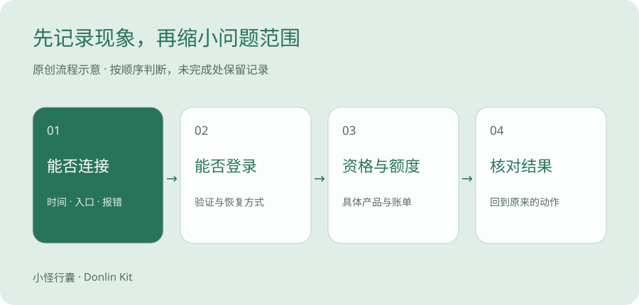

# AI 使用常见问题，如何判断问题出在哪里

按连接、账号、服务支持、额度付款和输出质量分层判断。示例问题与真实发生的故障分开记录。

> 原创排查框架＋官方认证说明 · 资料修订版 · 待本人实测 · 2026-10-28

页面转了半天，Codex 没有返回结果。脑子里很容易冒出两个判断，账号是不是封了，线路是不是坏了。

先把眼前的现象写下来，再决定下一步。

一个报错，还说明不了全部原因。

## 把故障当成快递，看看停在哪一站

从打开页面，到完成登录，再到提交任务、拿到结果，可以先分成几个环节。就像一件快递停在取件、运输还是派送，需要的处理动作不同。这个类比只帮助定位，不是网络协议说明。

说真的，统一写成「不能用了」，别人很难帮你。写成「主页能打开，登录后提交任务提示额度不足」，范围已经小得多。

本篇是通用判断方法。没有你的错误原文和实际环境，不能据此诊断你个人账号为什么出现异常。

## 先保存一条可以复查的现象

记录时间、入口、设备类型、错误原文、你刚刚执行的动作和期待结果。截图先遮挡账号、订单、验证码等信息。

下面是排查情景示例，不代表已经收到十名用户的问题，也不是已经在你的设备上复现的故障。真实问题记录表初始为空。



原创排查路径，连接 → 登录 → 服务支持 → 额度付款 → 输出质量。

## 担心封号时，先分辨你看到的现象

「固定线路」「住宅 IP」「付费账号」等名称不能提供账号不被限制的保证。具体服务仍有自己的地区、身份与使用规则。

1. 网络超时、登录过期、权限不足、额度限制和明确的账号暂停通知，分别记录。
2. 单独看到无法连接、401 或 403，不能据此认定账号已经永久封禁。先保留错误原文及发生环节。
3. 收到明确的暂停或停用通知时，通过相应官方支持或申诉入口处理；不要承诺换线路就能解封。
4. 恢复过程中不向第三方提供密码、验证码、API 密钥或认证文件。

## 线路访问问题，先缩小排查范围

Codex 官方认证文档可以帮助你区分登录方式、对应账单和凭证保护要求。它不能单独解释每一次网络故障，也不能用 API 的地区列表代替所有客户端的使用条件。

1. 确认失败发生在打开页面、登录回调，还是发送任务之后。
2. 使用本人已有、允许使用的网络，在一次只改变一个条件的情况下比较；不新增购买线路。
3. 查看官方服务状态，并记录时间、设备与错误；浏览器能打开不代表客户端或某项功能也已正常。
4. 公司网络或设备有策略限制时，向网络管理员核实；不关闭证书验证或安全软件来试错。

## 用现象定位下一步

| 看到的现象 | 先确认什么 | 下一步 |
| --- | --- | --- |
| 网页无法打开 | 官方域名、其他普通网站、设备网络与服务状态。 | 先保存报错，查看官方状态或支持；不要立即购买新账号。 |
| 登录或验证码失败 | 登录方式、邮箱或号码是否仍由本人掌握。 | 使用官方恢复入口，检查输入、有效期与平台提示。 |
| 提示地区或资格不符 | 具体产品、实际使用地点与官方支持条件。 | 查该产品对应说明，选择符合本人条件的工具。 |
| 提示额度或频率限制 | 当前模式、产品套餐、官方额度与刷新说明。 | 按官方提示等待或调整任务；不猜测固定恢复时间。 |
| 扣费但功能未开通 | 订单渠道、账号、订单状态与扣款状态。 | 通过对应官方订单或支持入口查询，避免重复购买。 |
| 答案与材料不一致 | 原文是否完整、提示词是否限制来源。 | 缩小任务、保留原文、分项核对数值和未知条件。 |
| 图文看起来像编造经历 | 输入是否给出了真实经历与可引用证据。 | 删除没有证据的第一人称叙事，明确演示性质。 |

## 给客服的信息可以这样整理

普通问题记录表不保存密码、验证码、完整卡号、恢复代码或 API 密钥。官方确需核验身份时，由本人在相应渠道完成。

```text
问题发生时间与时区：
官方服务及入口：
设备与系统类型：
期待结果：
实际现象及错误原文：
已尝试步骤：
脱敏截图或必要的订单查询信息：仅通过官方要求的渠道提交
尚未确认的条件：
```

## 输出质量问题，先做一个小测试

第 4、5 篇提供可复现的虚构材料和编辑示例。不要据此声称某款工具在所有任务上更好。

1. 把任务缩到一段可核对的原文。
2. 要求「只根据原文」，输出参数名、数值、单位和未知项。
3. 逐条对照，记录具体错误，不只写「效果不好」。
4. 修改提示词后再测一次，只比较这个任务的结果。

## 什么时候记录为未解决

没有读到明确官方说明、现象不能复现或本人不具备继续测试条件时，记录为「待确认」。保存已知事实和下一条核查动作即可。

维护时先处理影响资格、收费或账号安全的变化。旧结论失效后标记日期、更新相关段落，并保留修订说明。

## 三种情景，看看记录方式有什么不同

遇到处置通知，从自己确认过的官方入口登录查看，必要时向官方支持核实。邮件里的按钮和声称解封的第三方，都不能代替官方判断。

| 情景示例 | 能确定的事实 | 还不能得出的结论 |
| --- | --- | --- |
| 主页一直超时 | 这次访问没有在预期时间内完成。 | 不能证明账号被封，也不能确定是哪段网络出问题。 |
| 登录后提示额度不足 | 该页面给出了额度相关提示。 | 不能直接推断已付订阅失效；先核对具体产品和登录方式。 |
| 收到明确的账号暂停通知 | 有一条需要核实的账号处置通知。 | 不能保证换线路恢复，也不能按陌生邮件链接直接提交凭证。 |

## 线路问题，先做一次最小比较

保持同一台设备、同一个入口和同一个动作，先保存报错。查看该服务的官方状态页面；如果有明确故障，记录公告时间和影响范围。状态正常也不代表你这一侧一定正常。

如果本人已有另一种允许使用的网络，可以只改变网络后再做同一动作。前后结果有差异，说明值得继续调查网络或访问路径，但仍不足以锁定某个具体原因。

其实吧，一次把网络、账号、浏览器和客户端全换掉，反而不知道是哪项起作用。先只改一个条件。

受公司管理的设备和网络，向管理员核实代理、防火墙或证书策略。本文不指导关闭证书验证，也不把特定网络名称当成账号安全保证。

## 官方申诉需要的是事实

写清时间、服务、动作、现象和已尝试步骤，附上必要的脱敏截图。无法判断的地方直接写待确认，不替客服猜结论。

你想想看，「昨晚十点提交任务后出现某段错误，重新登录后仍然存在」比「平台乱封号」更方便核查。申诉没有本文保证的固定结果或时限。

如果对方要求你交出密码、验证码或恢复代码，再声称能帮忙解封，先停下来，从官方渠道核实。

## 怎么知道自己真的解决了

回到原来失败的那个动作，重复一次，记录结果。能打开主页，不等于任务已经完成；换了一次网络，也不等于永久解决。

坦率地讲，有些问题当下没有足够材料定位。写下尚未解决和下一条核查动作，保留记录，比编一个确定原因更有用。下一次遇到提示，先保存原文。

冬零小怪 · 小怪行囊 · Donlin Kit

如果这篇帮你看懂了一步，可以收藏、分享给同样刚开始的朋友，也欢迎记下还没看懂的问题。

## 来源与核查范围

1. [OpenAI 官方认证说明](https://learn.chatgpt.com/docs/auth)。已读取官方认证原文，核对 ChatGPT 订阅访问与 API 按用量访问的区别，以及认证缓存保护说明。未读取或更改个人凭证。 核查日期 2026-10-28。

2. [DeepSeek 官方首页与网页版入口](https://www.deepseek.com/)。已阅读官方首页；确认网页版、应用下载、API 平台是不同入口。未核实个人订阅价格与本人账号资格。 核查日期 2026-10-28。

3. [千问官方入口（通义入口跳转）](https://www.qianwen.com/)。通义入口跳转至千问，已读取官方页面标题。当前账号、功能和费用条件待本人进一步核实。 核查日期 2026-10-28。

4. [OpenAI API：支持的国家与地区](https://developers.openai.com/api/docs/supported-countries)。已阅读 API 地区列表及使用范围说明。这是 API 文档，不能据此推定 ChatGPT 的地区或订阅条件。 核查日期 2026-10-28。

本文未加入推荐佣金链接。个人工具实测、订单及资格仍待本人验证。
